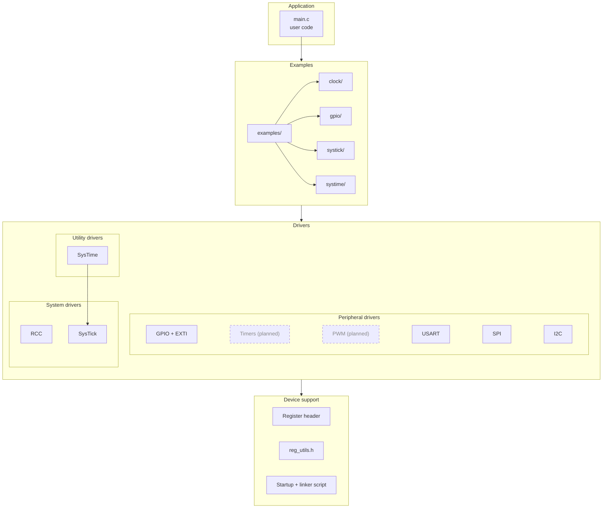

# STM32F401XX-Drivers

Bare-metal C drivers for the STM32F401XX ( tested on F401RE ), without HAL or CMSIS drivers. 
Every driver builds on the host against a fake register model, so the logic is unit-tested without a board.

## Drivers

Each driver has its own folder with a public header, source, and a README with the API, usage example and limits.

| Driver | Purpose | Host tests | On hardware | Docs | Example |
|---|---|---|---|---|---|
| GPIO + EXTI | Pins, alternate functions, EXTI callbacks | Yes | Verified | [README](drivers/GPIO_driver/README.md) | [gpio](examples/gpio) |
| RCC | Clock tree, PLL, MCO, LSI/LSE | Yes | Verified (84 MHz PLL, MCO) | [README](drivers/RCC_driver/README.md) | [clock](examples/clock) |
| SysTick | Core tick timer with callback | Yes | Verified | [README](drivers/SYSTICK_driver/README.md) | [systick](examples/systick) |
| SysTime | Millisecond time base, delays, timeouts | Yes | Verified | [README](drivers/SYSTIME_driver/README.md) | [systime](examples/systime) |
| USART | Polling, interrupt, ring buffer | TBD | TBD | [README](drivers/USART_driver/README.md) | TBD |
| SPI | Master transfers | TBD | TBD | [source](drivers/SPI_driver) | TBD |
| I2C | Master transfers | TBD | TBD | [source](drivers/I2C_driver) | TBD |

## Quick start

```sh
git clone --recurse-submodules [https://github.com/Almighty42/STM32F401XX-Drivers](https://github.com/Almighty42/STM32F401XX-Drivers)
cd STM32F401XX-Drivers
make test                 # host unit tests, no board needed
make examples             # cross-build all examples
```

Requirements: GNU Arm Embedded toolchain (`arm-none-eabi-gcc`), `make`, a host
C compiler, and OpenOCD for flashing.

## Project structure

```
STM32F401XX-Drivers/
├── drivers/
│   ├── GPIO_driver/                  # GPIO and EXTI
│   │   ├── README.md                 # API, example, limits
│   │   ├── stm32f401xx_GPIO_driver.c
│   │   ├── stm32f401xx_GPIO_driver.h # Public API and limits
│   │   └── stm32f401xx_GPIO_regs.h   # Private register encodings
│   ├── I2C_driver/
│   ├── RCC_driver/                   # Clock tree, PLL, MCO, LSI/LSE
│   ├── SPI_driver/
│   ├── SYSTICK_driver/               # Core tick timer with callback
│   ├── SYSTIME_driver/               # Millisecond time base, delays, timeouts
│   └── USART_driver/                 # Polling, interrupt, ring buffer
├── generic/                          # Shared by every driver
│   ├── reg_utils.h                   # Bit and field helpers
│   ├── startup.c                     # Vector table and reset handler
│   ├── stm32f401xx.h                 # Register structs and base addresses
│   └── stm32_ls.ld                   # Linker script
├── examples/                         # Runnable programs
│   ├── clock/
│   │   ├── lse_mco/                  # 32.768 kHz LSE on PA8
│   │   └── mco_out/                  # 84 MHz PLL, 16.8 MHz on PA8
│   ├── gpio/
│   │   ├── basic_blink/              # LED on PA5
│   │   └── button_blink/             # Button on PC13 through EXTI
│   ├── systick/
│   │   └── tick_blink/               # 1 kHz tick with a callback
│   └── systime/
│       ├── delay_blink/              # Blocking delay at 84 MHz
│       └── timeout_poll/             # Debounced button, non-blocking timer
├── test/                             # Unity host tests, fake register model
├── mk/                               # Shared makefile for the examples
├── third_party/                      # Unity (git submodule)
├── docs/                             # Extra notes
├── .github/                          # CI workflows
├── Doxyfile
├── LICENSE
├── Makefile                          # test, examples, check
└── README.md
```

## Driver diagram



## Examples

Each example is a small program you can flash and measure. The code and
wiring live in the README of the driver it demonstrates, not here.

| Example | What it shows | Driver docs |
|---|---|---|
| [`gpio/basic_blink`](examples/gpio/basic_blink) | LED on PA5 | [GPIO](drivers/GPIO_driver/README.md) |
| [`gpio/button_blink`](examples/gpio/button_blink) | Button on PC13 through EXTI | [GPIO](drivers/GPIO_driver/README.md) |
| [`clock/mco_out`](examples/clock/mco_out) | 84 MHz PLL, 16.8 MHz on PA8 | [RCC](drivers/RCC_driver/README.md) |
| [`clock/lse_mco`](examples/clock/lse_mco) | 32.768 kHz LSE on PA8 | [RCC](drivers/RCC_driver/README.md) |
| [`systick/tick_blink`](examples/systick/tick_blink) | 1 kHz tick with a callback | [SysTick](drivers/SYSTICK_driver/README.md) |
| [`systime/delay_blink`](examples/systime/delay_blink) | Blocking delay at 84 MHz | [SysTime](drivers/SYSTIME_driver/README.md) |
| [`systime/timeout_poll`](examples/systime/timeout_poll) | Debounced button, non-blocking timer | [SysTime](drivers/SYSTIME_driver/README.md) |

Every example folder builds with `make` and flashes with `make flash`

## Conventions

- Arguments are validated before any register is touched, so a failed call
  changes nothing.
- Every call that can fail returns a status enum, with 0 meaning OK.
- Limits live in the public header, register encodings in a private `_regs.h`.
- Drivers do not configure pins or the NVIC. The application does.
- No dynamic allocation. Callbacks carry a user context pointer.

## Limitations

Targets the F401xD/xE only. Not tested on other STM32 parts. Not
production-hardened: no MISRA check, no static analysis yet.

## License

MIT. See [LICENSE](LICENSE).
