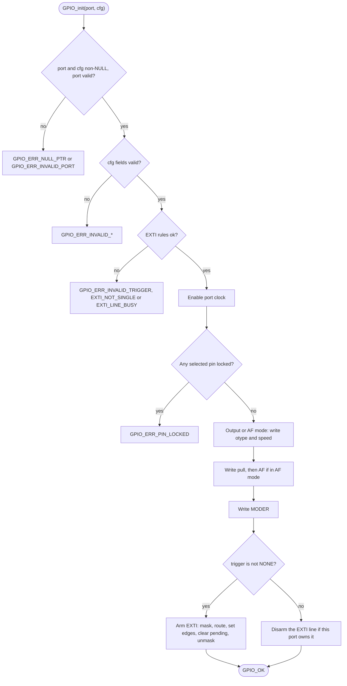
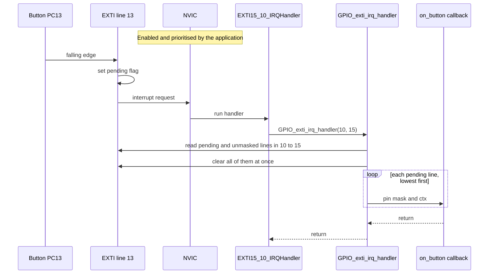

# GPIO driver

GPIO and EXTI driver for the STM32F401xD/xE, tested on the NUCLEO-F401RE.

- Pins are passed as bit masks (`GPIO_PIN_5`, `GPIO_PIN_2 | GPIO_PIN_3`), never as indices.
- `GPIO_init` configures one or more pins in a single call: mode, output type, speed,
  pull, alternate function and an optional EXTI trigger.
- `BSRR`-based set, reset, toggle and masked write, plus pin and port reads.
- EXTI with per-line callbacks: `GPIO_exti_irq_handler` finds the pending lines,
  clears them and calls your callback.
- Per-pin and per-port de-init, with the real reset values of the SWD/JTAG pins.
- Configuration lock (`GPIO_lock_pins`).
- Every call that can fail returns a `GPIO_status_t`.

## Driver usage examples

```c
const GPIO_config_t led = {.pins = GPIO_PIN_5, .mode = GPIO_MODE_OUTPUT,
                           .speed = GPIO_SPEED_FAST};
const GPIO_config_t btn = {.pins = GPIO_PIN_13, .mode = GPIO_MODE_INPUT,
                           .pull = GPIO_PULL_UP, .trigger = GPIO_TRIG_FALLING};

GPIO_init(GPIOA, &led);
GPIO_init(GPIOC, &btn);
GPIO_exti_set_callback(GPIO_PIN_13, on_button, NULL);
NVIC->ISER[IRQ_NO_EXTI15_10 / 32U] = 1U << (IRQ_NO_EXTI15_10 % 32U);

void EXTI15_10_IRQHandler(void) { GPIO_exti_irq_handler(10, 15); }
```

## Code examples

Both examples target the NUCLEO-F401RE and use its onboard LD2 LED on PA5.
Build and flashing commands are in each example's README.

| Example | Demonstrates | Hardware |
|---|---|---|
| [`basic_blink`](../../examples/gpio/basic_blink) | Output configuration and `GPIO_toggle` | LD2 / PA5 |
| [`button_blink`](../../examples/gpio/button_blink) | Input configuration, EXTI callback and interrupt handling | B1 / PC13, LD2 / PA5 |

`button_blink` enables `EXTI15_10_IRQn` in the application and calls
`GPIO_exti_irq_handler(10, 15)` from `EXTI15_10_IRQHandler`. This is
intentional: the GPIO driver owns EXTI configuration and dispatch, while the
application owns NVIC configuration and the vector handler.

## API

| Function | Purpose |
|---|---|
| `GPIO_init(port, cfg)` | Configure one or more pins: mode, output type, speed, pull, alternate function and an optional EXTI trigger. |
| `GPIO_set(port, pins)` | Drive pins high through `BSRR`. |
| `GPIO_reset(port, pins)` | Drive pins low through `BSRR`. |
| `GPIO_toggle(port, pins)` | Invert pins. |
| `GPIO_write(port, mask, value)` | Masked write: change only the pins in `mask`. |
| `GPIO_read_pin(port, pin)` | Read one pin. |
| `GPIO_read_port(port)` | Read the whole port. |
| `GPIO_pin_deinit(port, pins)` | Return pins to their reset state. |
| `GPIO_port_deinit(port)` | Reset every pin on the port. |
| `GPIO_lock_pins(port, pins)` | Lock the pin configuration until the next reset. |
| `GPIO_exti_set_callback(pin, cb, ctx)` | Register a callback for one EXTI line. |
| `GPIO_exti_irq_handler(first, last)` | Call from the ISR with the range of lines it covers. |

### Status codes

`GPIO_OK` is 0. Every error is non-zero.

| Code | Meaning |
|---|---|
| `GPIO_ERR_NULL_PTR` | A required pointer was NULL. |
| `GPIO_ERR_INVALID_PORT` | `port` is not a valid GPIO port. |
| `GPIO_ERR_INVALID_*` | A field of `cfg` is out of range. |
| `GPIO_ERR_INVALID_TRIGGER` | The trigger is not usable with this configuration. |
| `GPIO_ERR_EXTI_NOT_SINGLE` | A trigger was requested for a mask with more than one pin. |
| `GPIO_ERR_EXTI_LINE_BUSY` | Another port already owns that EXTI line. |
| `GPIO_ERR_PIN_LOCKED` | At least one selected pin is locked. |

## How it works

### What `GPIO_init` does

Validation touches no register, so a call that fails validation leaves the
hardware unchanged. The steps from "Write otype and speed" to the EXTI step repeat
for every pin in the mask.



### From button press to callback

The application enables the EXTI interrupt in the NVIC and calls
`GPIO_exti_irq_handler` from the ISR. The driver clears the pending flags first,
then calls the callbacks in ascending line order, so keep callbacks short.



## Notes and limits

- The driver does not modify / configure the NVIC.
- `GPIO_init` is not safe to call from an ISR on the same port as other code.
- `GPIO_lock_pins` locks a whole port once: lock every pin you need in a single
  call. Only a reset removes the lock.
- `GPIO_port_deinit` resets every pin on the port, including other drivers' pins.

## Tests

Host unit tests (Unity, fake registers): `make -C test test`.
