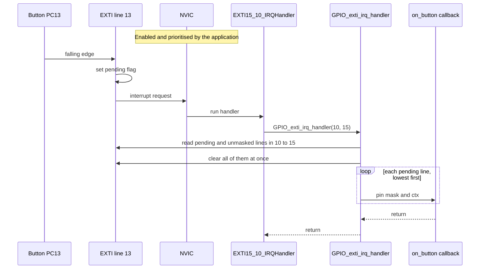

# GPIO driver

GPIO and EXTI driver for the STM32F401xD/xE, tested on the NUCLEO-F401RE.

- Pins are passed as bit masks (`GPIO_PIN_5`, `GPIO_PIN_2 | GPIO_PIN_3`), never as indices.
- `GPIO_init` configures one or more pins in a single call: mode, output type, speed,
  pull, alternate function and an optional EXTI trigger.
- `BSRR`-based set, reset, toggle and masked write, plus pin and port reads.
- EXTI with per-line callbacks: `GPIO_exti_irq_handler` finds the pending lines,
  clears them and calls your callback.
- Per-pin and per-port de-init, with the real reset values of the SWD/JTAG pins.
- Configuration lock (`GPIO_lock_pins`).
- Every call that can fail returns a `GPIO_status_t`.

## Example

```c
const GPIO_config_t led = {.pins = GPIO_PIN_5, .mode = GPIO_MODE_OUTPUT,
                           .speed = GPIO_SPEED_FAST};
const GPIO_config_t btn = {.pins = GPIO_PIN_13, .mode = GPIO_MODE_INPUT,
                           .pull = GPIO_PULL_UP, .trigger = GPIO_TRIG_FALLING};

GPIO_init(GPIOA, &led);
GPIO_init(GPIOC, &btn);
GPIO_exti_set_callback(GPIO_PIN_13, on_button, NULL);
NVIC->ISER[IRQ_NO_EXTI15_10 / 32U] = 1U << (IRQ_NO_EXTI15_10 % 32U);

void EXTI15_10_IRQHandler(void) { GPIO_exti_irq_handler(10, 15); }
```

Examples of how to use the driver are in `examples/button_blink`.

## How it works

### What `GPIO_init` does

Validation touches no register, so a call that fails validation leaves the
hardware unchanged. The steps from "Write otype and speed" to the EXTI step repeat
for every pin in the mask.


### From button press to callback

The application enables the EXTI interrupt in the NVIC and calls
`GPIO_exti_irq_handler` from the ISR. The driver clears the pending flags first,
then calls the callbacks in ascending line order, so keep callbacks short.



## Notes and limits

- The driver does not modify / configure the NVIC.
- A pin switched to output starts low (there is no initial-level option yet).
- `GPIO_init` is not safe to call from an ISR on the same port as other code.
- `GPIO_lock_pins` locks a whole port once: lock every pin you need in a single
  call. Only a reset removes the lock.
- `GPIO_port_deinit` resets every pin on the port, including other drivers' pins.

## Tests

Host unit tests (Unity, fake registers): `make -C test test`.
