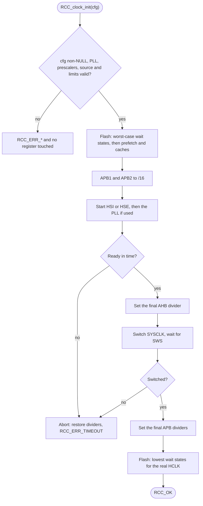
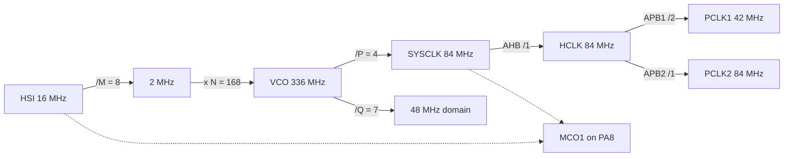

# RCC driver

Clock tree driver for the STM32F401xD/xE, tested on the NUCLEO-F401RE:
oscillators, PLL, bus prescalers, clock frequency queries, MCO1 output and the
low-speed oscillators (LSI, LSE).

- `RCC_clock_init` applies a complete clock configuration (source, PLL,
  AHB/APB1/APB2 prescalers) in one call.
- Every PLL, prescaler and frequency limit is checked before any register is
  touched, so a call that fails validation leaves the hardware unchanged.
- Flash wait states and the prefetch and cache bits are handled for you.
- `RCC_get_sysclk_hz`, `RCC_get_hclk_hz`, `RCC_get_pclk1_hz` and
  `RCC_get_pclk2_hz` read the real frequencies back from the registers.
- `RCC_mco1_config` routes HSI, LSE, HSE or the PLL to PA8 through a divider.
- LSI and LSE control, including backup domain write access for the LSE.
- Every call that can fail returns an `RCC_status_t`.

## Driver usage example

The 84 MHz setup used by the examples: HSI into the PLL, AHB undivided, APB1 at
half speed.

```c
const RCC_clock_config_t clk = {
    .sysclk = RCC_SYSCLK_PLL,
    .pll = {.src = RCC_PLL_SRC_HSI, .m = 8, .n = 168, .p = 4, .q = 7},
    .ahb_div = RCC_AHB_DIV_1,
    .apb1_div = RCC_APB_DIV_2,
    .apb2_div = RCC_APB_DIV_1,
};

if (RCC_clock_init(&clk) != RCC_OK) {
    /* the previous clock is still running */
}

uint32_t hclk = RCC_get_hclk_hz(); /* 84000000 */
```

Any peripheral that derives its timing from a clock must be set up after this
call, for example `SYSTIME_init(RCC_get_hclk_hz())`.

## API

| Function | Purpose |
|---|---|
| `RCC_clock_init(cfg)` | Apply a complete clock configuration. |
| `RCC_get_sysclk_hz()` | SYSCLK in Hz, read from the registers. |
| `RCC_get_hclk_hz()` | HCLK (AHB, core, SysTick) in Hz. |
| `RCC_get_pclk1_hz()` | APB1 peripheral clock in Hz. |
| `RCC_get_pclk2_hz()` | APB2 peripheral clock in Hz. |
| `RCC_mco1_config(src, div)` | Route a clock to PA8 through a divider. |
| `RCC_lsi_enable()` | Start the LSI and wait until it is ready. |
| `RCC_lsi_disable()` | Stop the LSI. |
| `RCC_lse_start(bypass)` | Start the LSE without waiting. |
| `RCC_lse_ready()` | `true` once the LSE is stable. |
| `RCC_lse_stop()` | Stop the LSE. |

### Status codes

`RCC_OK` is 0. Every error is non-zero.

| Code | Meaning |
|---|---|
| `RCC_ERR_NULL_PTR` | A required pointer was NULL. |
| `RCC_ERR_INVALID_PLL` | M, N, P or Q out of range, or a VCO limit violated. |
| `RCC_ERR_INVALID_PRESCALER` | A prescaler is not one of the enum values. |
| `RCC_ERR_FREQ_LIMIT` | SYSCLK, APB1 or APB2 above its maximum. |
| `RCC_ERR_INVALID_SOURCE` | Source not usable, for example HSE with `hse_hz` set to 0. |
| `RCC_ERR_TIMEOUT` | An oscillator, the PLL or the clock switch did not become ready. |

## Limits

These come from RM0368 and are enforced by `RCC_clock_init`. The driver assumes
a 2.7 V to 3.6 V supply.

| Parameter | Range |
|---|---|
| SYSCLK, HCLK | up to 84 MHz |
| APB1 | up to 42 MHz |
| APB2 | up to 84 MHz |
| PLL input (source / M) | 1 to 2 MHz |
| M, N, Q | 2 to 63, 50 to 432, 2 to 15 |
| P | 2, 4, 6 or 8 (the value, not the register encoding) |
| VCO (source / M * N) | 192 to 432 MHz |
| VCO / Q (48 MHz domain) | at most 75 MHz |
| PLL output (VCO / P) | at least 24 MHz |

## Examples

Each example is a complete program for the NUCLEO-F401RE. Build and flash
commands are in `mk/example.mk` and each example's Makefile.

| Example | Demonstrates | Check with |
|---|---|---|
| [`clock/mco_out`](../../examples/clock/mco_out) | 84 MHz PLL, then PLL / 5 on PA8 | 16.8 MHz square wave on PA8 |
| [`clock/lse_mco`](../../examples/clock/lse_mco) | LSE start with a timeout, LSE on PA8 | 32.768 kHz on PA8, LED blinks at 1 Hz |
| [`systime/delay_blink`](../../examples/systime/delay_blink) | The same 84 MHz setup feeding SysTime | LED blinks at about 1 Hz |

On failure, `lse_mco` and `delay_blink` leave the LED steady on. In `mco_out`,
a missing signal on PA8 means the PLL setup failed.

## How it works

### What `RCC_clock_init` does

Validation touches no register. After that the driver runs a fixed sequence
so the core never runs faster than its flash and buses allow.



If the PLL is currently running the core, the driver steps down to HSI before
it reprograms the PLL, because the PLL configuration can only change while the
PLL is off.

### Clock tree for the example configuration

The numbers match the 84 MHz example above.



## Low-speed oscillators

- **LSI:** `RCC_lsi_enable` starts it and waits a bounded number of loop
  iterations. On timeout it switches the LSI off again and returns
  `RCC_ERR_TIMEOUT`. Its accuracy is poor, so do not use it for timekeeping.
  It has no effect on `RCC_lsi_disable` while the IWDG is running.
- **LSE:** the backup domain is write-protected after reset. `RCC_lse_start`
  enables the PWR clock and sets `PWR_CR.DBP` first, then turns the oscillator
  on. It does not wait, because a crystal can take a long time to start.
  Poll `RCC_lse_ready` with a timeout of your own.
- **Bypass:** `bypass` selects an external clock on OSC32_IN instead of a
  crystal. The setting is only applied while the LSE is off.
- **Pins:** do not configure PC14 and PC15 with the GPIO driver while the LSE
  is in use.

## Notes and limits

- The driver does not configure pins. For MCO1 the caller sets PA8 to
  alternate function 0 with the GPIO driver, and the selected source must
  already be running.
- At high frequencies divide the MCO output (for example `RCC_MCO_DIV_5`): the
  pin cannot output 84 MHz cleanly.
- A failed `RCC_clock_init` leaves the previous clock running. SYSCLK is either
  unchanged, or HSI when the PLL had been in use. Dividers are restored, but
  the flash wait states may stay high.
- The driver never turns off an oscillator or PLL it no longer uses. After a
  switch back to HSI, a running HSE or PLL keeps drawing current.
- Waits are bounded by a loop count, not by time.
- `RCC_clock_init` is not safe to call from an ISR.
- The HSE frequency is stored by the last successful `RCC_clock_init`. The
  getters report it when HSE or an HSE-fed PLL is the system clock. They
  return 0 if the registers hold a PLL setting the driver would reject.
- Changing the clock changes the timing of SysTick, UART baud rates and
  timers. Reconfigure them afterwards.
- There is no API to turn peripheral clocks on or off. Each peripheral driver
  gates its own clock.
- Not covered: the I2S and 48 MHz clock selection, RTC clock selection, the
  clock security system, MCO2 and the reset flags.

## Tests

Host unit tests (Unity, fake registers): `make -C test test`. The fake models
the oscillator and PLL ready flags and the clock switch, with failure flags so
the timeout and abort paths are exercised.
