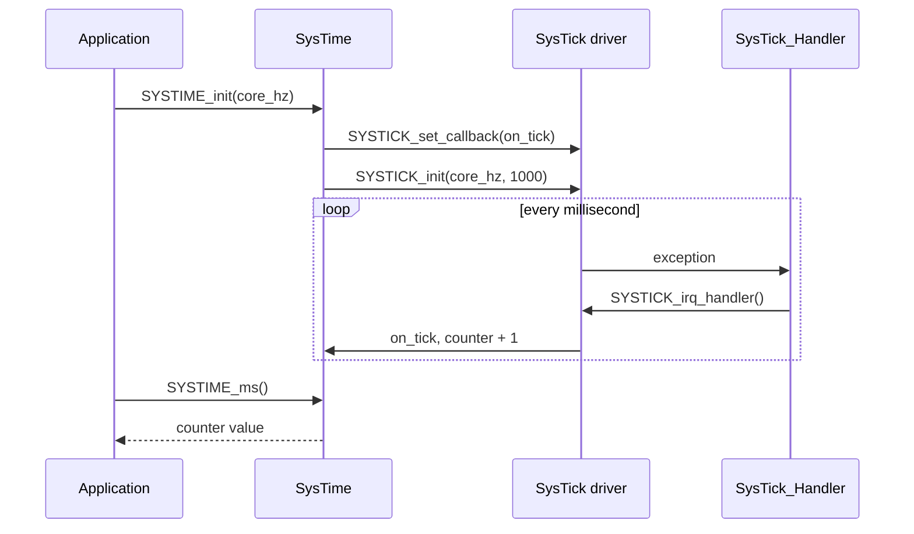
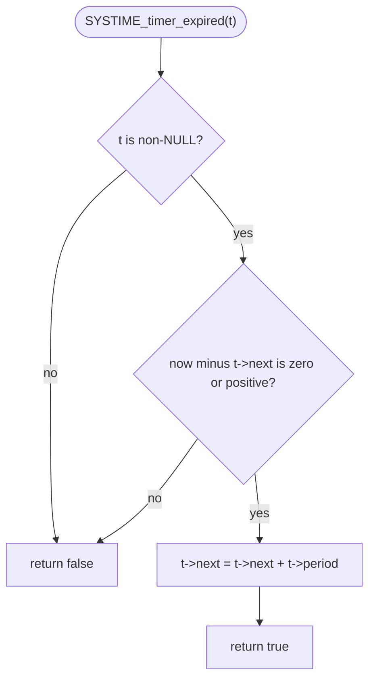

# SysTime driver

Millisecond time base, blocking delay and non-blocking timeouts for the
STM32F401xD/xE, built on the SysTick driver and tested on the NUCLEO-F401RE.

- `SYSTIME_init` starts a 1 kHz tick and counts milliseconds in a 32-bit
  counter.
- `SYSTIME_ms`, `SYSTIME_since` and `SYSTIME_elapsed` read the time and test
  timeouts. They are wrap-safe, and `SYSTIME_ms` can be called from an ISR.
- `SYSTIME_delay_ms` blocks for at least the requested time and sleeps with
  `wfi` between ticks.
- `SYSTIME_timer_start` and `SYSTIME_timer_expired` give periodic software
  timers that do not drift.
- The driver registers its own callback with SysTick, so the application
  needs no tick code of its own.
- `SYSTIME_init` returns a `SYSTIME_status_t`. The other calls cannot fail.

## Driver usage example

Blink an LED every 500 ms without blocking, and wait for 10 ms once at start-up.

```c
SYSTIME_timer_t blink;

if (SYSTIME_init(RCC_get_hclk_hz()) != SYSTIME_OK) {
    /* the time base is not running */
}

SYSTIME_delay_ms(10U);
SYSTIME_timer_start(&blink, 500U);

for (;;) {
    if (SYSTIME_timer_expired(&blink)) {
        GPIO_toggle(GPIOA, GPIO_PIN_5);
    }
}

void SysTick_Handler(void) { SYSTICK_irq_handler(); }
```

The application still provides `SysTick_Handler`, because the vector table
belongs to the application. Call `SYSTIME_init` again after every clock
change.

## API

| Function | Purpose |
|---|---|
| `SYSTIME_init(core_hz)` | Start the 1 kHz time base and register it with SysTick. |
| `SYSTIME_ms()` | Milliseconds since `SYSTIME_init`, modulo 2^32. |
| `SYSTIME_since(start_ms)` | Milliseconds elapsed since `start_ms`, wrap-safe. |
| `SYSTIME_elapsed(start_ms, timeout_ms)` | `true` once at least `timeout_ms` have passed. |
| `SYSTIME_delay_ms(ms)` | Block for at least `ms` milliseconds. |
| `SYSTIME_timer_start(t, period_ms)` | Start a periodic timer. |
| `SYSTIME_timer_expired(t)` | `true` once per period, then advance the timer. |

### Status codes

`SYSTIME_OK` is 0. Every error is non-zero.

| Code | Meaning |
|---|---|
| `SYSTIME_ERR_TICK_RATE` | SysTick could not provide `SYSTIME_TICK_HZ` at this core clock. |

## Limits

| Parameter | Value |
|---|---|
| Resolution | 1 ms (`SYSTIME_TICK_HZ` is 1000) |
| Counter wrap | after about 49.7 days (2^32 ms) |
| Absolute deadlines | valid within 2^31 ms (about 24.8 days) of now |
| Timer period | below 2^31 ms |
| Core clock | any value SysTick accepts for 1 kHz; the tick is exact only when `core_hz` is a multiple of 1000 |

Compare times only through `SYSTIME_since`, `SYSTIME_elapsed` and the timer
functions. Never compare two values from `SYSTIME_ms` directly, because the
counter wraps.

## Examples

Each example is a complete program for the NUCLEO-F401RE. Build and flash
commands are in `mk/example.mk` and each example's Makefile. The `DRIVERS`
list in each example's Makefile needs both `SYSTIME_driver` and
`SYSTICK_driver`.

| Example | Demonstrates | Check with |
|---|---|---|
| [`systime/delay_blink`](../../examples/systime/delay_blink) | `SYSTIME_delay_ms` on the 84 MHz clock | LD2 blinks at about 1 Hz |
| [`systime/timeout_poll`](../../examples/systime/timeout_poll) | A periodic timer for an exact 500 ms, with a polled button | LD2 blinks at 1 Hz, button pauses and resumes it |

On failure both examples leave the LED steady on.

## How it works

### Layers

SysTime owns one counter. SysTick increments it once per millisecond through a
callback, so SysTime itself never touches a register.



### What `SYSTIME_timer_expired` does

It adds exactly one period to the next expiry each time it fires, so the
average rate does not drift.



If you poll a timer several periods late, it returns `true` on consecutive
calls until it has caught up. A period of 0 returns `true` on every call.

## Notes and limits

- `SYSTIME_delay_ms` waits one extra tick, so the delay is never shorter than
  requested. `SYSTIME_delay_ms(0)` waits one tick.
- `SYSTIME_delay_ms` needs a running tick. Call it only after `SYSTIME_init`
  returned `SYSTIME_OK`, with interrupts enabled. Before that it never
  returns.
- Never call `SYSTIME_delay_ms` from the SysTick interrupt, or from an
  interrupt of equal or higher priority. The tick cannot advance there.
- The counter is written only by the tick callback, and 32-bit reads are
  atomic on the Cortex-M4, so `SYSTIME_ms` is safe from ISRs.
- `SYSTIME_init` registers the callback before it starts SysTick, so the first
  tick is never lost. A re-init keeps the counter's value but can lose up to
  one tick.
- A start time in the future gives a huge elapsed value. Always pass a value
  returned earlier by `SYSTIME_ms`.
- `SYSTIME_timer_start` and `SYSTIME_timer_expired` ignore a NULL timer
  pointer: start does nothing, expired returns `false`.
- The driver does not set the SysTick exception priority.
- Changing the clock changes the tick rate. Call `SYSTIME_init` again.
- Not covered: sub-millisecond timing, a real-time clock and a 64-bit
  counter.

## Tests

Host unit tests (Unity, fake registers): `make -C test test`. The tests
define `SYSTIME_IDLE_HOOK` so the fake time advances while a delay waits, and
`SYSTIME_TESTING` to set the counter near the wrap point.
